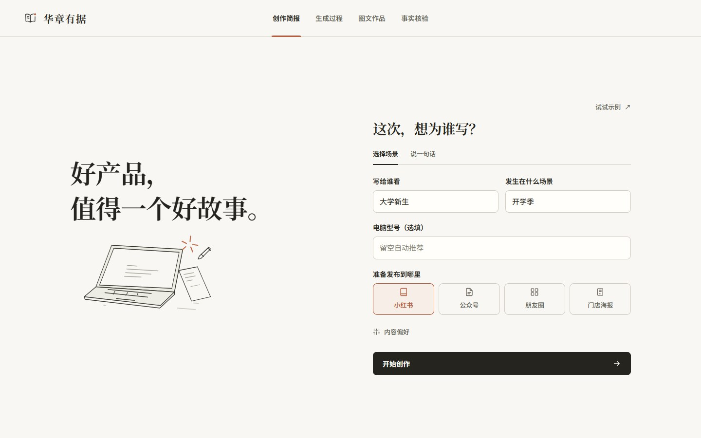
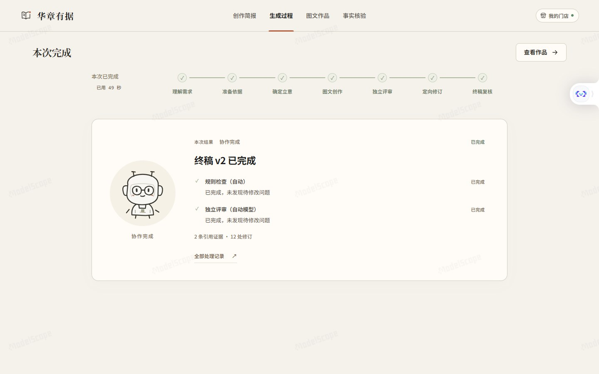
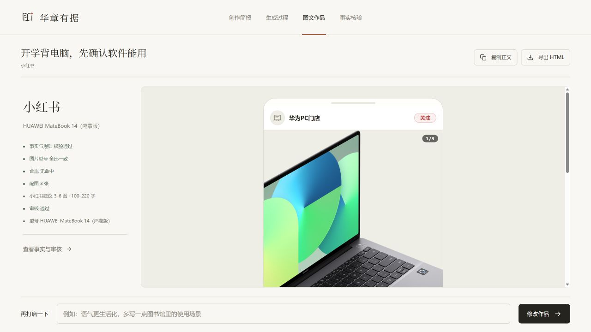
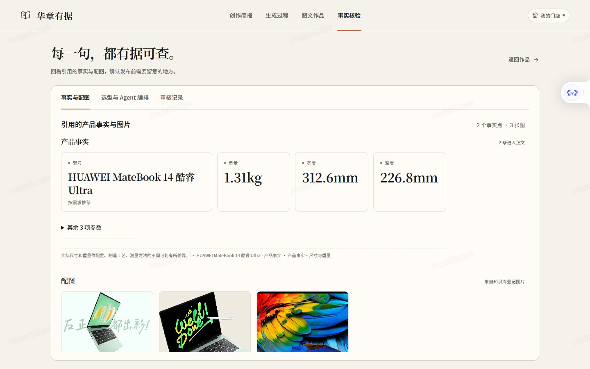

# 华章有据

**从产品知识出发，生成有据可查的华为电脑营销图文。**

v1.0.0 · 首个正式版。[在线体验](https://ballcard-huazhang-youju.ms.show) · [图文介绍](https://ballcard-huazhang-youju.ms.show/about) · [魔搭主页](https://modelscope.cn/studios/BallCard/huazhang-youju) · [部署与配置](docs/deployment.md)

> 个人项目副本，独立于比赛协作仓库。产品资料不进入 GitHub，仅在本机和已授权的私有创空间保留部署副本。

## 快速体验

打开[体验入口](https://ballcard-huazhang-youju.ms.show)，魔搭会自动跳转到全屏创空间页面。使用项目作者单独提供的演示账号登录，无需魔搭账号或模型密钥。点击「进入体验」后，选择「试试示例」，或写一句自己的需求，再开始创作。生成后可查看配图与事实来源、复制正文、导出含图片的 HTML。

创空间使用 `protected` 模式：应用入口可访问，代码仓库隐藏；工作台另有演示账号验证。账号密码不写在 README 中，队友和评委由作者单独告知。

## 界面一览

以下为当前版本的真实运行截图；生成样例使用魔搭 Qwen 与 DeepSeek。

**开屏 · 一句话认识华章有据**


**创作简报 · 指定人群、场景与发布平台**



**Agent 接力 · 查看真实执行阶段与耗时**



**图文作品 · 平台版式预览、复制与导出**



**事实核验 · 对照引用片段、型号与登记图片**



## 模型与资料

| 环节 | 当前部署模型 | 调用来源 |
| --- | --- | --- |
| 场景解析、推荐、事实提取、修订 | `Qwen/Qwen3.5-35B-A3B` | 魔搭推理 API |
| 图文写作 | `deepseek-ai/DeepSeek-V4.1-Flash-1017` | 魔搭推理 API |
| 独立审核 | `deepseek-ai/DeepSeek-V4.1-Flash-1017`，独立调用与上下文 | 魔搭推理 API |
| 数字、型号、图片登记、篇幅与合规规则 | 本地 Python 规则 | 无模型调用 |

部署版所有在线模型调用均走魔搭，消耗魔搭账号的推理配额或资源；不调用 DeepSeek 官方 API。知识库使用已预置的产品资料包，图片描述已离线预计算。IMA 实时读取尚未实现，访问者不需要另配资料源或密钥。

## 运行

```bash
pip install -r src/mvp/requirements.txt
python -X utf8 -m src.mvp.app        # http://127.0.0.1:7860
```

也可以双击 `start.cmd`。首次运行将 `.env.example` 复制为 `.env`，放好 `data/kb` 资料包与 `data/cache/vision.json`。模型走 OpenAI 兼容接口；本机配置默认指向已有反代。

启动前可运行 `python -X utf8 scripts/preflight.py`；加 `--check-model` 会真实调用三个角色模型检查 JSON 返回。部署专用配置可用环境变量 `APP_ENV_FILE=.env.deploy` 指定，不覆盖本机 `.env`。

## 功能

- **独立开屏**：Logo、名称与一句话描述依次出现，点击「进入体验」进入工作台；同一标签页刷新或恢复任务时跳过，支持减少动态效果。
- **平台原生版式预览**：顶部切换电脑 / 手机并保留选择；电脑端小红书左图右文、公众号宽栏阅读、朋友圈桌面动态流，手机端保留图片轮播与九宫格，门店竖版海报维持原样。窄屏首次默认手机模式，电脑首次默认电脑模式。
- **两种场景输入**：结构化选择人群与使用场景，或直接用一句话描述需求；机型留空时按需求推荐。
- **一屏一页**：创作简报 → 生成过程 → 图文作品，事实核验单独查看；图文只在预览区内滚动，操作始终可见。
- **Agent 接力可视化**：纸感手绘 Q 版 Bot，执行时外圈旋转；快速步骤也会依次亮起、打勾和交接，展示队列不阻塞后台执行，完成后再进入作品页；点击头像查看真实状态与耗时，刷新时直接恢复当前进度。
- **场景示例**：内置常见场景，先填入简报，修改后再开始生成。
- **证据优先**：产品事实只来自知识库，逐条标注来源；图片使用知识库登记图，缺整机图时允许联网检索华为官网。
- **图片画面分类与联网补图**：整机优先，首图必须是整机图；缺图时优先读取已登记的华为官方产品页，必要时通过联网搜索发现官网页面。仅采用完整型号匹配、产品专属路径、尺寸与视觉检查均通过的整机图，保存原网页、原图 URL、核验时间及文件摘要；七天内复用缓存，下载与导出走本地已核验文件。来源或画面无法确认、联网失败、视觉模型不支持时仍显示缺图。可用 `WEB_IMAGE_SEARCH=0` 关闭，`IMAGE_VERIFY_MODEL` 默认为 FAST 模型并复用其接口。
- **核验—修订—独立审核**：数字、型号、图片、价格、合规规则表 + 独立审核模型。
- **平台短文案**：小红书 100–220 字、公众号 240–480 字，按平台原生图文顺序输出；总字数、单段、标题与图注上限均参与核验。写法与来源见 [风格说明](docs/writing-style.md)。
- **小范围展示部署**：Cookie 登录、单实例并发限制、SQLite 保存任务与结果；重启后保留已完成作品，未完成任务明确标记为中断。独立审核有异议时显示待人工复核。
- **模型分工**：部署版通过魔搭推理 API 调用 Qwen 做解析、推荐、提取与修订，DeepSeek 做写作和独立审核；密钥只保存在服务端。

## 速度

- 当前全魔搭配置的单次小红书样例约 30 秒；实际耗时会随模型排队、篇幅与修订次数变化。
- “质量优先”使用上表各角色模型；“快速创作”写作与审核也切到 FAST 模型。重复输入可复用场景与事实缓存，写作和审核仍真实调用模型。
- 创作页“内容偏好”中可切换档位，并填写传播目标与额外限制。

## 目录

```text
src/mvp/
  app.py          FastAPI 服务
  pipeline.py     编排流程、核验、缓存
  kb.py           知识库读取与图片索引
  verify.py       确定性核验
  llm.py          模型调用
  tag_images.py   图片视觉标签生成
  config/         场景与平台策略表
  prompts/        各环节提示词
  web/            前端（无构建步骤）
data/kb/          知识库本地副本（gitignore）
data/cache/       视觉标签缓存（gitignore）
```

## 说明

- `data/`、`.env`、`.env.deploy`、`model.txt` 均不进入 GitHub；换机器时需要重新放置资料与密钥。魔搭部署资料只同步到指定私有创空间。
- v1.0 使用本地资料包；IMA 实时读取、ZIP 上传、管理员配置面板与多用户隔离尚未实现。
- 本版面向本人及受邀演示者，使用共享访问账号；生成后可复制正文、导出含图片的 HTML，不会自动发布到社交平台。
- 没有依据的价格、补贴、库存、销量、奖项不得写入稿件；发布前以官方渠道为准。
- 图片视觉标签可用 `python -X utf8 -m src.mvp.tag_images --model gemini-3.8-flash-low` 重新生成。
