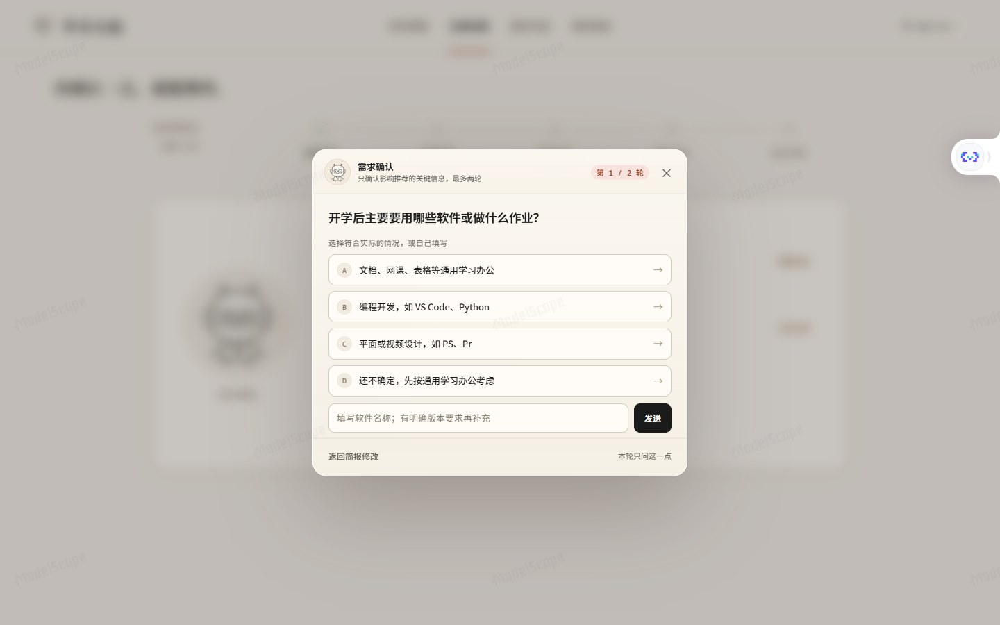
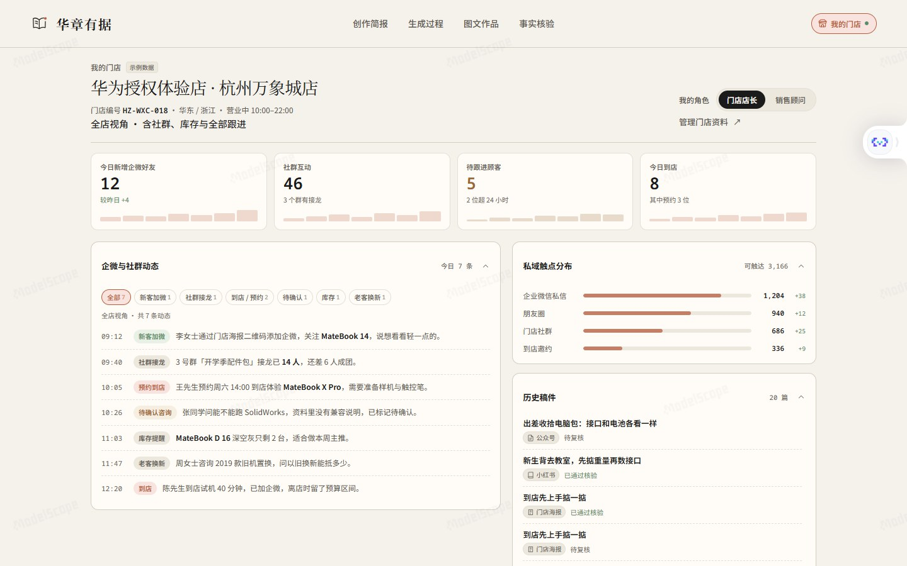

# 华章有据 · 华为电脑营销图文工作台

> 从产品知识出发，为门店与私域生成有据可查的华为电脑营销图文。

[](https://ballcard-huazhang-youju.ms.show)
[](https://modelscope.cn/studios/BallCard/huazhang-youju)
[](https://ballcard-huazhang-youju.ms.show/about)

**体验入口**：[https://ballcard-huazhang-youju.ms.show](https://ballcard-huazhang-youju.ms.show)  
公开演示环境，无需注册魔搭、无需登录账号，打开即用。

---

## 核心功能一览

华章有据将华为电脑产品资料库、用户真实痛点场景与多渠道私域触点深度打通。通过多 Agent 协同编排，从需求澄清、内容策划、图文写作到事实核验与独立评审，确保营销内容的每一句话、每一张配图都有据可查。

### 1. 独立开屏 · 极简进入

打开即用，无需配置 API 或繁琐登录。一句话了解项目定位，点击「进入体验」即可直达工作台。


### 2. 创作简报 · 四步一屏直达

支持结构化选择与一句话自然语言输入双模式。清晰串联「人群场景 → 发布平台 → 经营目标 → 私域触点」营销闭环链路，支持指定电脑型号或留空由 Agent 智能推荐。


### 3. 需求追问 · 居中磨砂面板

当用户输入需求存在模糊或冲突时，自动触发居中轻量追问面板。单轮聚焦关键问题，提供贴合实际使用场景的选项与自填入口，选中即自动继续，不打断创作心流。



### 4. Agent 接力 · 实时编排与透明进展

需求解析、选型推荐、证据匹配、内容策划、写作编辑、确定性规则检查、独立交叉评审与定向修订分工协作。手绘 Bot 轮转展示各环节真实操作、资料来源与实时耗时。


### 5. 图文作品 · 原生平台版式预览与打磨

提供小红书、微信公众号、门店朋友圈、门店海报等原生平台视觉预览，支持电脑端与手机端自适应切换。支持「换种语气」、「突出卖点」一键二次打磨，支持正文复制与完整离线 HTML 导出。


### 6. 事实核验 · 每一句皆有据可查

生成内容中的每一项产品参数和性能描述，均精准回溯到知识库原始条目并展示适用条件；配图限定为对应型号的官方登记图片；独立审核记录与修改建议清晰展示，疑点一目了然。


### 7. 我的门店 · 经营看板与私域联动

面向品牌门店店长与销售顾问，提供门店经营看板、企微与社群动态分类筛选、私域触点分布，以及真实历史生成稿件沉淀，助力门店日常精细化私域运营。



---

## 基本信息

### 支持体裁与平台规范

| 平台渠道 | 内容体裁 | 适用场景 | 输出特色 |
| --- | --- | --- | --- |
| **小红书** | 种草笔记 | 校园生活、日常通勤、痛点共鸣 | 原生左图右文/轮播，吸睛标题，标签推荐，精炼篇幅 |
| **微信公众号** | 深度图文 | 选购攻略、出差拆解、功能测评 | 结构化章节排版，严谨引用，阅读节奏舒适 |
| **门店朋友圈** | 动态图文 | 老客互动、日常答疑、到店邀约 | 亲切短文案，配图九宫格组合，突出行动入口 |
| **门店海报** | 宣传海报 | 店内展示、商场立牌、活动通知 | 醒目大标题，核心卖点聚焦，视觉留白，支持高清下载 |

### 模型架构与分工

- **统一文字角色**：采用魔搭推理 API 驱动的 `deepseek-ai/DeepSeek-V4.1-Flash-1017`，负责场景解析、选型推荐、证据匹配、内容策划、写作编辑、定向修订与文字独立评审（评审采用独立上下文）。
- **视觉核验与配图审核**：采用独立的多模态视觉模型 `Qwen/Qwen3.5-35B-A3B`，执行配图完整性与画面规范检查。
- **确定性规则引擎**：本地 Python 规则引擎进行参数范围、型号存在性、图片登记一致性、合规词与平台字数硬性校验。

---

## 快速运行

```bash
# 安装依赖
pip install -r src/mvp/requirements.txt

# 启动本地服务（默认端口 7860）
python -X utf8 -m src.mvp.app
```

启动后在浏览器打开 `http://127.0.0.1:7860` 即可使用。

---

## 使用须知与边界

- **知识库基准**：当前预置知识库以华为官方公开产品资料与规格为准。
- **免责与人工复核**：生成内容用于辅助营销创作，价格、促销活动、库存与具体销售政策受时间及地域影响，最终发布前应以华为官方渠道与门店实际情况为准。
- **安全与合规**：本系统不自动发布内容至任何第三方平台，确保所有输出经过人工最终确认。
