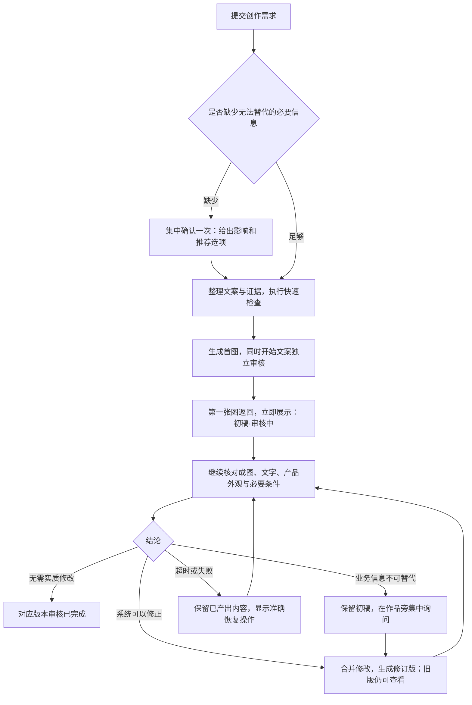

# 首图与审核流程重设计

日期：2026-10-21。阶段：流程方案及交互原型；尚未接入正式工作台。

已确认方向：先给可以修改、明确标注审核状态的初稿；审核完成后再形成定稿。

## 产品约定

用户点击开始后，系统先产出能讨论的第一版海报。初稿返回即展示，独立审核在后台继续。用户可以看图、提出修改，也可以等待审核完成。审核问题默认由系统处理，只在缺少必要业务决定时打断用户。

首图是初稿，不借用“审核通过”状态；审核完成指对应版本的自动检查已完成，不等同于已对外发布。

## 用户会经历什么

此处“集中确认一次”指把已知必要缺口放在一次交互里，而非强制每个任务先回答一轮。后续确有新缺口时，需要说明新增原因，不能重复问已回答的问题。

## 首图前做什么

首图前只做需求完整性、机型与参考图匹配、明显数值错误、禁止承诺等快速检查，并尽可能把事实范围限制到已选证据。完整语义审核和交叉复核不再作为所有初稿的统一串行前置条件。

- 未指明审美、背景、语气等偏好：采用合理默认，展示后再改。
- 无依据的价格、补贴、库存、性能或兼容性承诺：删除或替换为有依据表达；不能因为要快而填入未知事实。
- 缺项可以省略且不改变核心目标：省略并记入说明，继续生成。
- 型号无法确定、所需产品参考不可用、用户明确必须展示的活动条件不完整：集中确认具体业务问题，提供补充或调整目标的选项。
- 即使采用保守文案也无法保证最低有效性：明确说明阻塞原因；不承诺每个输入一定能出图。

## 把谁应该解决的问题交给谁

| 情况 | 默认处理 | 对用户的呈现 |
| --- | --- | --- |
| 语气、配色、构图偏好 | 初稿后由用户选择是否修改 | 修改入口，不弹必答问题 |
| 明确的错字、数字、漏条件、错型号 | 系统先修文案，再核对；必要时合并重生 | “正在修正”，保留旧版和修改说明 |
| 非核心、无法核实的宣传句 | 删除或弱化至已有证据能支持的范围 | 处理记录；不要求用户裁决模型对错 |
| 用户明确必需、只能由门店决定的活动或业务事实 | 集中索取必要信息或允许去掉该内容 | 一张决定卡，说明选择对画面的影响 |
| 独立审核未完成、模型意见互相冲突 | 有界复核；无法解决则保留准确待核验状态 | 自动处理失败后给“继续核验”，不伪装为人工问题 |
| 生图请求超时 | 按原任务继续查询；不重复提交 | “继续等待本次生图” |
| 服务明确失败且无可恢复任务 | 保留文案与参考，说明原因 | “重试生图”，不重问需求 |

用户可以提供门店自己的活动事实和资料，但不能通过勾选“我认为误判”就把客观产品风险自动改成审核通过。人工采用、自动检查通过、尚未解决的问题分别记录。

## 同一个作品页的状态与操作

| 状态 | 主体与主提示 | 主要操作 |
| --- | --- | --- |
| 生成中，尚无图 | 生成过程与已完成的文案，不跳到空白成品页 | 修改先记为待应用，避免并发重复提交 |
| 初稿已返回，审核中 | 首图常驻，标“初稿 · 审核中”；说明系统仍在检查 | 提交修改；查看收起的核验记录 |
| 系统修订中 | 保留旧图，标“旧版待替换”；显示修订原因 | 查看版本；保存下一条修改意见 |
| 待补充必要信息 | 保留初稿，旁边显示一张业务决定卡 | 推荐的处理选项；补充所需信息 |
| 审核已完成 | 展示经过对应版本检查的当前稿 | 下载定稿；继续修改 |
| 未完成或失败 | 保留已有图与文案，区分继续查询、继续核验和重新提交 | 与失败阶段对应的恢复按钮 |

不再用一条“待自动修订或重试”同时代表多个原因。没有图片时不显示“还想怎么打磨”；有初稿时使用“先看看这个方向”，审核完成后再用“还想怎么打磨”。

可以保留带可见审核状态的初稿预览，待审核内容不能通过“下载定稿”入口导出。最终实现若允许下载初稿，应明确叫“下载初稿（待核验）”，并在导出文件中保留该状态。

## 后台处理与版本规则

1. 首图和审核采用分别记录的状态。运行中的任务也可拥有可见初稿，前端读取进行中产物，不等待整个任务 `done` 后才展示。
2. 生图使用冻结文案快照。记录文案版本、内容摘要、参考摘要、供应方任务 ID、图片版本与图片摘要。审核结论绑定具体快照，旧版通过不能套到新版。
3. 文案独立审核可与生图并行；成图检查必须等待真实图片。若并行审核发现问题，首图仍作为旧版初稿展示并说明问题。将文案和成图实质问题收齐后合并修改，避免分别触发多次重生。
4. 默认最多两轮文案自动纠正、一次首图后的自动重生；预算是上限，检查通过即可结束。每轮必须消除具体问题或获得新证据。同一根因再次出现且没有进展时停止循环，准确保留状态。
5. 初稿前最多一个生图请求在途。后续已提交且供应方无法取消的请求继续查询原任务，不因轮询超时重复提交。新需求先保存，合并到下一个版本。
6. 用户提交修改时，新建修改版本；旧审核可以留存，但不能覆盖新版本状态。后台不得覆盖用户正在输入的意见，也不静默切换用户正在对照的旧图。
7. 重生后的图必须再次检查。重生失败时保留旧图和已修订文案；不能将旧图标为新文案的定稿。
8. 用户主动修改进入新的明确执行周期；系统不能借“自动处理”无限增加调用次数。刷新页面恢复同一任务与版本，不重新问已知需求。

上述轮数是首版建议的工程上限，尚未经过线上耗时和费用试验。落地时需结合现有单任务并发限制与模型实际响应调整，不承诺固定出图秒数。

## 视觉与交互规范

- 用途：门店创作者快速看到第一版，并随时知道当前是在等系统还是需要自己决定。
- 方向：编辑工作台。保留现有纸感与克制的产品表达。
- 配色：暖纸 `#F6F4EF`、墨色 `#25241F`、陶土 `#AD6146`、鼠尾草 `#62735B`、分隔 `#DED9CF`。深色随宿主切换；不改品牌和字体体系。
- 字体：Noto Serif SC 用于品牌与主要标题，Noto Sans SC 用于文案与操作。具体字重沿用项目规范。
- 布局：海报占主视区；左栏只放本次最重要的动作。状态贴近作品版本，详细核验用原位展开。手机端状态、海报、操作依次排列。
- 原型展示为本地交互演示，产品图使用已有本机登记素材；示例中的审核结论、修订与状态均为演示，不代表真实任务审核。

## 实现边界

这次产出方案与交互原型，保留正式工作台现状，未修改 API、任务状态机、提示词、部署或线上任务。后续落地需要一起调整编排、进行中产物展示、审核归属和导出权限，单改 `text_approved()` 会让风险与版本关系失真。

涉及入口：`src/mvp/app.py` 的后台任务衔接、`pipeline.py` 的审核预算、`poster.py` 的生图与审核分离、`review.py` 的业务决定分流，以及作品页与过程页的进行中展示。

验收以这些行为为准：信息足够时不主动弹问询；首图返回即显示；机器错误不产生必答问卷；必要问题集中出现且不重复；审核失败仍保留首图；轮询恢复不重复提交；旧审核不能批准新图；未通过的版本不能以定稿导出；刷新恢复同一状态。

## 原型验证记录

2026 年 10 月 21 日已在本地交互原型中验证：

- 初稿状态可以先展示海报，提交“标题再短一点”后进入修订中，旧图保留，定稿下载保持禁用。
- 必要业务信息状态只显示活动规则决定卡；选择补充并提交规则后进入修订中，去掉优惠的推荐路径也保留。
- 审核完成状态只开放对应当前版本的“下载定稿”；从 v2 再修改时保留 v2 并显示“修订版 v3 准备中”。
- 生图等待超时状态显示“继续查询原任务”，点击后不改变需求和参考，也不产生重复提交提示。
- 在 390px 与 320px 视口下检查了窄屏布局，未发现横向溢出；状态、海报、修改入口和记录按顺序排列。

以上是原型交互验证，不代表正式工作台、供应方任务或线上审核已经接入或通过验收。
